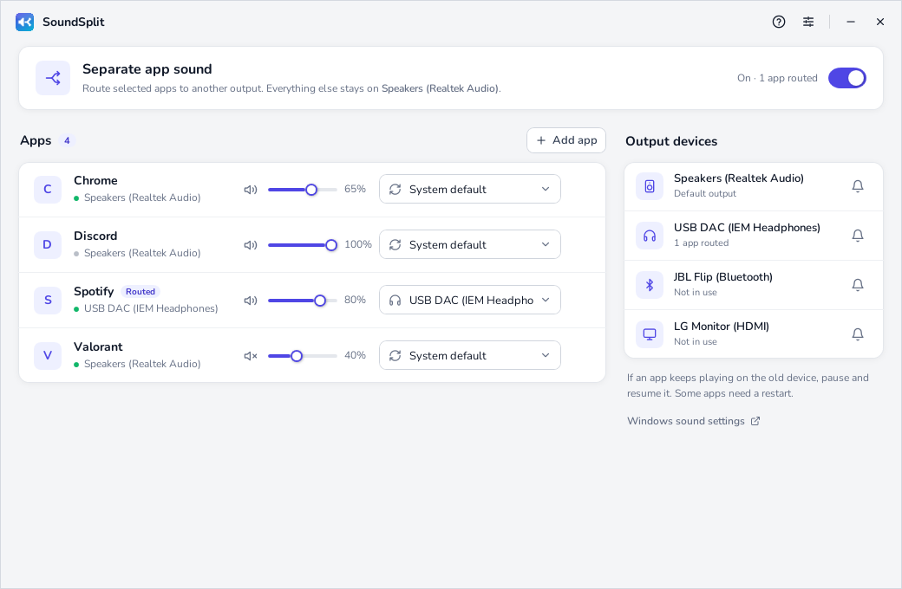
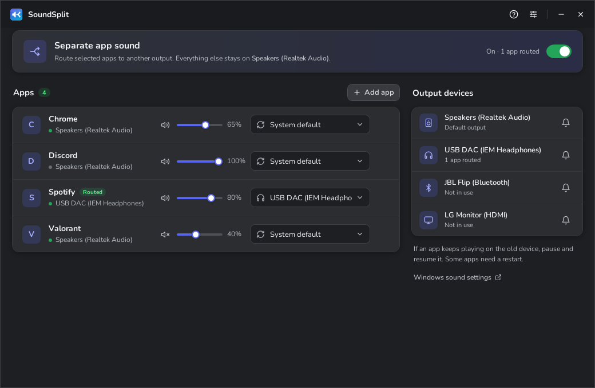

# SoundSplit

Per-app audio output. Route any app to its own speaker or headphones and leave everything else on the default device.

**[Download the latest release](https://github.com/byjoelsamuel/SoundSplit/releases/latest)** · Windows 10/11 (`SoundSplit.exe`) · Android 10+ (`SoundSplit-android.apk`)



<details>
<summary>Dark theme</summary>



</details>

## Windows

- Pick an output device (and optionally a mic) for each app
- Choices persist and re-apply when the app starts
- Per-app volume and mute, test sound per device
- Minimal mode: a small window with just apps and outputs (button in the title bar, or *Settings → Minimal mode*)
- Tray icon, start with Windows
- Themes: Light, Midnight, Aero, Classic 98

Routing is handled by Windows itself (the same mechanism as *Settings → Sound → Volume mixer*), so no drivers or virtual cables are needed and no latency is added.

**Usage**

1. Run `SoundSplit.exe`. It's unsigned, so SmartScreen may ask: *More info → Run anyway*.
2. Make sure routing is switched on (top right).
3. Play audio in an app, or add it with **Add app**.
4. Choose a device from the app's output dropdown.

If an app doesn't switch immediately, pause and resume playback. Some apps need a restart. Settings live in `%AppData%\SoundSplit\`. Run with `--demo` to preview the UI with sample data.

Requires Windows 10 1803 or later. The release is a self-contained exe; no .NET install needed.

## Android

A minimal one-screen app: pick apps, pick an output, press **Start**.

Android doesn't let one app move another app's audio to a different device (only some manufacturers, e.g. Samsung's *Separate app sound*, build this in). SoundSplit uses what Android does allow: it **captures** the chosen apps' audio, the same permission screen recorders use, and plays it on the output you pick.

- **Silence original** (on by default) mutes media and re-plays *everything*: chosen apps go to your pick, all other apps go back to the normal output, so each sound comes from one place. While it's on, use the slider in SoundSplit for volume. Media volume is restored when you stop.
- Android asks for screen-recording permission each time you start. Choose *Entire screen*; only audio is used, nothing is recorded or saved.
- Expect a small delay (roughly 50–150 ms), fine for music, noticeable for video lip-sync.
- Apps that block capture (some streaming/DRM apps) can't be routed. Calls and notifications are never touched.

Install: download `SoundSplit-android.apk` from the release on your phone and allow installing from your browser when asked.

## How it's tested

The core logic has **fault-targeted tests**: each test names a specific way the code could break (wrong interface id, routing to an unplugged device, apps left on the wrong output after turning off, …) and fails if that happens. This follows [VIBEPASS](https://arxiv.org/abs/2603.15921) (Bansal et al., 2026), which found that AI-written tests usually *run* but rarely *expose real faults*, and that tests which miss the fault can make fixes worse.

To check the tests actually catch bugs, `tools/mutation_check.py` injects known bugs one at a time, including the interface-id bug that shipped in 1.0.0, and fails if any slip through. Both run in CI; the Windows job also exercises the real per-app audio API.

```sh
dotnet test tests/SoundSplit.Tests
python3 tools/mutation_check.py
```

Not covered automatically: the WPF UI (checked manually in `--demo` mode) and the Android app (built and linted in CI, tested by hand on devices).

## Building

**Windows** needs the [.NET 8 SDK](https://dotnet.microsoft.com/download/dotnet/8.0):

```powershell
cd SoundSplit
dotnet run
dotnet publish -c Release -r win-x64 --self-contained -p:PublishSingleFile=true -o publish
```

**Android** needs JDK 17 and the Android SDK (or Android Studio):

```sh
cd android
./gradlew assembleRelease
```

**Releases** are built by GitHub Actions: run the *SoundSplit* workflow with a version (e.g. `v1.2.1`) or push a `v*` tag. The release gets both `SoundSplit.exe` and `SoundSplit-android.apk`.

### Android signing (optional)

Add these repository secrets (*Settings → Secrets and variables → Actions*) to sign the APK with your own key. Without them it's signed with a throwaway debug key, which installs fine but can't be updated in place by the next release.

| Secret | Value |
| --- | --- |
| `ANDROID_KEYSTORE_BASE64` | the keystore file, base64-encoded |
| `ANDROID_KEYSTORE_PASSWORD` | keystore password |
| `ANDROID_KEY_ALIAS` | key alias |
| `ANDROID_KEY_PASSWORD` | key password |

## Project structure

```
SoundSplit/   Windows app (WPF, .NET 8)
  Core/         per-app routing, devices/sessions, settings
  ViewModels/   UI state
  Themes/       palettes, line icons, control styles
android/      Android app (Kotlin, Jetpack Compose)
tests/        fault-targeted tests for the core logic
tools/        mutation check
```

## Credits

[NAudio](https://github.com/naudio/NAudio) (MIT) · [Nunito](https://fonts.google.com/specimen/Nunito) (OFL) · per-app endpoint research from [EarTrumpet](https://github.com/File-New-Project/EarTrumpet)
