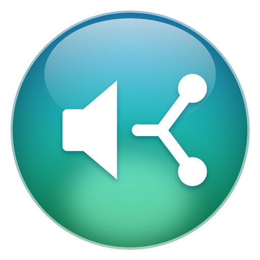

<p align="center">
  
</p>

<h1 align="center">SoundSplit</h1>

<p align="center"><b>Choose which speaker or headphones each app plays on in Windows.</b><br/>
Spotify in your IEMs, the game on your speakers, Discord on your headset, all at the same time.</p>

---

## What is it?

Some Samsung phones have a setting called **"Separate app sound"**. You pick an app and a device, and only that app's sound goes to that device. SoundSplit does the same thing on **Windows 10 and 11** PCs, with a simple bubbly window.

```
 Spotify  ─────────────►  🎧 IEMs / USB DAC
 Game     ─┐
 Chrome   ─┼───────────►  🔊 Main speakers
 Discord  ─┘
```

- ✅ No drivers, no virtual audio cables, no extra lag. Windows does the routing itself.
- ✅ Remembers your choices (even after a reboot).
- ✅ Per-app volume and mute.
- ✅ Optional: choose a **mic** per app too (for example, Discord on your headset mic).
- ✅ 3 themes: **Aero** (glossy Frutiger Aero), **Classic 98** (old Windows look), **Midnight** (dark).
- ✅ Runs quietly in the tray and can start with Windows.
- ✅ Free and open source. No account, no internet, **no API keys**.

---

## 🚀 Tutorial (about 2 minutes)

### Step 1: Get the app

1. Open this repo on GitHub → the **Actions** tab → the latest **"SoundSplit (Windows app)"** run.
2. Scroll down to **Artifacts** and download **SoundSplit-windows**.
   *(If someone has published a **Release**, you can grab `SoundSplit.exe` from the Releases page instead.)*
3. Unzip it. You get one file: **`SoundSplit.exe`**. Put it anywhere you like, for example on your Desktop or in `Documents\Apps`.

> You don't need to install anything else. The .NET runtime is built into the .exe, which is why it's about 70 MB.

### Step 2: Open it

Double-click **`SoundSplit.exe`**.

The first time, Windows may show a blue box that says **"Windows protected your PC"**. That happens because the app isn't code-signed (code signing certificates cost money), not because it's harmful.
Click **More info** → **Run anyway**.

### Step 3: Turn it on

At the top there's a card called **Separate app sound**. Make sure the **Turn on now** switch is **green**.

### Step 4: Find your app

Play something in the app you want to move (a song in Spotify, a YouTube video, a game…).
It shows up in the **Apps** list within a second or two.

**Not showing up?** Click **➕ Add an app** and pick it from the list of open apps.
If it's closed, use **"App not open? Find its .exe"**.

### Step 5: Choose where it plays

On the app's card, open the **PLAY ON** dropdown and choose a device, for example **USB DAC (IEM Headphones)**.

That's it! 🎉 The app now plays on that device, and every other app stays on your main speakers.

> **Which device is which?** In **Your audio devices** on the right, press the 🔔 bell next to a device. You'll hear a little chime on it.

### Step 6 (optional): Extras

Click the ⚙️ gear in the top-right corner:

| Setting | What it does |
| --- | --- |
| **Aero / Classic 98 / Midnight** | Changes the look instantly. |
| **Start with Windows** | SoundSplit opens silently in the tray when you log in. |
| **Keep running when closed** | Clicking ✕ hides the window next to the clock instead of quitting. |
| **Pick a mic per app too** | Adds a **MIC** dropdown to every app card. |
| **Reset everything** | Sends every app back to the default device. |

To quit completely, right-click the SoundSplit icon by the clock → **Quit**.

---

## 💡 Example setups

| You want… | Do this |
| --- | --- |
| Music in your IEMs while a game plays on speakers | Spotify → **PLAY ON: your IEM/DAC** |
| Discord calls in your headset, everything else on speakers | Discord → **PLAY ON: headset** (+ **MIC: headset mic**) |
| A YouTube tutorial on your monitor's speakers while you game | Chrome → **PLAY ON: Monitor (HDMI)** |
| Stream alerts on one device, game audio on another | OBS / browser source → its own device |

---

## 🛠️ Troubleshooting

**The app didn't move to the new device.**
Pause and play it again. Some apps (older games, a few media players) only pick up the change after a restart.

**I chose a device, unplugged it, and now the app plays on my speakers.**
That's expected. Windows falls back to your main device, and SoundSplit moves the app back as soon as you plug the device in again.

**Bluetooth headphones aren't in the list.**
Connect them in Windows first (Settings → Bluetooth). Only devices that are connected and turned on appear.

**There's a red bar that says "Not supported".**
You need Windows 10 version 1803 (April 2018 Update) or newer. Run Windows Update.

**I want everything back to normal.**
Flip **Turn on now** off, or use ⚙️ → **Reset everything**.

**Where are my settings saved?**
`%AppData%\SoundSplit\settings.json`. Delete that folder to start fresh. If something ever goes wrong, details are in `error.log` in the same folder.

**Can I just try the look first?**
Run `SoundSplit.exe --demo`. It shows fake apps and devices and doesn't change anything.

---

## 🧠 How it works (for the curious)

Windows 10 (1803+) and 11 already have a hidden per-app output feature. It's what powers
**Settings → System → Sound → Volume mixer** on Windows 11 (on Windows 10 it's **Advanced sound options → App volume and device preferences**).
That screen is hard to find and only shows apps that are playing at that moment.

SoundSplit talks to the same built-in Windows component (`Windows.Media.Internal.AudioPolicyConfig`) and adds:

- A list that finds apps automatically (Windows Core Audio sessions via [NAudio](https://github.com/naudio/NAudio)).
- Rules saved per app, re-applied every time the app starts.
- Per-app volume and mute, device test chimes, a tray icon, themes, and auto-start.

Because Windows does the routing, the audio never passes through SoundSplit. You get zero added latency and no quality loss, which matters if you're listening on a nice DAC or IEMs.

### Project layout

```
SoundSplit/
├─ Core/
│  ├─ AudioPolicyConfig.cs   ← talks to Windows' per-app routing
│  ├─ AudioDevices.cs        ← lists devices, app sessions, per-app volume
│  ├─ Router.cs              ← keeps Windows in sync with your rules
│  ├─ ProcessInfo.cs         ← app names, icons, exe paths
│  ├─ Settings.cs            ← settings.json + "Start with Windows"
│  ├─ TestTone.cs            ← the 🔔 chime
│  └─ DemoData.cs            ← fake data for --demo
├─ ViewModels/               ← what the UI binds to
├─ Themes/                   ← Aero.xaml, Classic.xaml, Midnight.xaml, Controls.xaml
├─ Assets/                   ← icon, logo, Nunito font (SIL Open Font License)
├─ MainWindow.xaml           ← the UI
└─ App.xaml(.cs)             ← startup, tray icon, single-instance
```

### Build it yourself

You need the [.NET 8 SDK](https://dotnet.microsoft.com/download/dotnet/8.0).

```powershell
cd SoundSplit
dotnet run                     # run it
dotnet publish -c Release -r win-x64 --self-contained true `
  -p:PublishSingleFile=true -p:IncludeNativeLibrariesForSelfExtract=true `
  -p:EnableCompressionInSingleFile=true -o publish
# → publish\SoundSplit.exe
```

Every push that changes `SoundSplit/` also gets built automatically by GitHub Actions (`.github/workflows/soundsplit.yml`).
When you publish a GitHub **Release**, the workflow attaches `SoundSplit.exe` to it.

---

## Credits

- Font: [Nunito](https://fonts.google.com/specimen/Nunito) by Vernon Adams, SIL Open Font License (`Assets/Fonts/OFL.txt`).
- Audio library: [NAudio](https://github.com/naudio/NAudio) (MIT).
- Inspired by Samsung's "Separate app sound" and EarTrumpet's research into Windows' per-app audio API.
